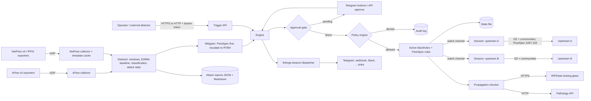

# Event Horizon Architecture

Automated RTBH in Rust. On DDoS detection it announces the victim prefix as a blackhole and sends the BGP community upstream; where upstreams support BGP FlowSpec it first rate-limits the attack traffic and escalates to a blackhole only when needed.

This document describes how Event Horizon is put together, where its trust boundaries are and how it behaves when things go wrong. It is the starting point for contributors; keep it up to date when you change the design.

## Design principles

- **Self-hosted, single binary.** No SaaS dependency, no external database. State is one JSON file plus an append-only audit log, attack reports and the alert queue in one data directory.
- **One choke point.** Every routing change (API, detector, escalation, approval, restore after restart, reload) is decided by `policy.rs`, deny by default. Nothing outside `protected` or inside `never` can ever be announced, as a host route or as a FlowSpec rule.
- **Fail safe and loud.** Invalid config, a missing secret, a TCP-MD5 requirement on an OS that cannot do it, or a corrupt state file stop the process at startup with a clear error.
- **Untrusted input everywhere.** sFlow, NetFlow v9, IPFIX, BGP messages, API requests, Telegram updates and HTTP responses from RIPEstat / Pathology are parsed defensively with explicit size limits. The only `unsafe` is one commented Linux `setsockopt(TCP_MD5SIG)` call.
- **Secrets from the environment.** Tokens, passwords and bot tokens are read from variables named in the config, never from files or logs.
- **Portable.** Linux, macOS and Windows; OS-specific code is `#[cfg]`-gated with a documented behaviour on the other systems.

## Data flow



## Source layout and components

| Module | Responsibility |
|---|---|
| `src/main.rs` | CLI (`run`, `check-config`, `simulate`, `silence`, `service`), startup checks, task wiring, configuration reload, shutdown. |
| `src/config.rs` | TOML schema (`deny_unknown_fields`), defaults, duration parsing and startup validation that reports every problem at once; merges legacy `[detect.sflow]` thresholds. |
| `src/policy.rs` | The single choke point. Blackholes: special addresses, `never`, `protected`, duplicates, `max_active`, TTL, scope (region / upstream subset). FlowSpec: same address and TTL rules plus enabled, protocol per family, ports only for TCP/UDP, allowed action, FlowSpec `max_active`. Bound on pending approvals. |
| `src/engine.rs` | Owns the active blackholes, FlowSpec rules and pending approvals. `submit` applies directly or parks a request for approval after a policy pre-check; `approve` re-runs the policy. Audits, persists, alerts and publishes to the sessions through a `watch` channel. TTL expiry, approval timeout (= deny), detector release, policy replacement on reload. |
| `src/state.rs` | Versioned JSON state (`entries` + `flowspec`) written to `<file>.tmp`, fsynced and renamed into place. Older files without FlowSpec / scope fields load unchanged. |
| `src/audit.rs` | Append-only JSON-lines audit log (`allow`, `deny`, `flowspec_allow`, `withdraw`, `expire`, `approval_*`, `restore*`, `bgp_*`, `reload`, `start`, `stop`). |
| `src/flow.rs` | Collector-independent `FlowSample` and a bounds-checked IPv4 / IPv6 / Ethernet header parser (ports only from first fragments). |
| `src/sflow.rs` | sFlow v5 flow samples (normal and expanded), raw packet headers, extended gateway source AS. |
| `src/netflow.rs` | NetFlow v9 and IPFIX: template and data sets, template cache keyed by exporter / domain / version / id with a size bound, IPFIX withdrawal, variable-length and enterprise fields, per-record sampling interval. |
| `src/detect.rs` | Detector (one-second buckets over a sliding window, hysteresis, EWMA baselines that can only lower thresholds, classification by packet majority, per-attack statistics), the `Mitigator` (FlowSpec first, escalation and fallback to RTBH, report on release) and the collector / evaluation tasks. |
| `src/report.rs` | Per-victim attack report (bounded top-N counters), JSON + Markdown files with pruning, in-memory list for the API. |
| `src/bgp/message.rs` | BGP-4 wire format: OPEN with MP (unicast and FlowSpec), 4-octet AS and Graceful Restart capabilities, UPDATE encoder for host routes, End-of-RIB, communities (global and regional) and a defensive UPDATE decoder. |
| `src/bgp/flowspec.rs` | FlowSpec rule model, NLRI encoding (RFC 8955 / 8956), traffic-rate extended community, defensive decoder used by tests and `simulate`. |
| `src/bgp/socket.rs` | Outgoing TCP socket: local address, multihop TTL / hop limit, Linux TCP-MD5; clear refusal elsewhere. |
| `src/bgp/session.rs` | One announce-only eBGP session per upstream: OPEN validation, timers, per-upstream desired set (scope, FlowSpec negotiation), diff-based announce / withdraw, EoR, reconnect with exponential backoff, Cease or graceful close. Dry-run logger. |
| `src/propagation.rs` | RIPEstat looking-glass and Pathology clients (time-boxed, size-limited, no redirects), status combination, periodic checker. |
| `src/approval.rs` | Telegram bot: posts pending requests with inline buttons, long-polls `getUpdates`, validates chat and user, calls `approve` / `reject`. |
| `src/api.rs` | axum router for blackholes, FlowSpec, approvals and reports; rate limit, constant-time bearer token, body limit, strict schemas; `/metrics` router including the llcforge-beacon counters. |
| `src/tls.rs` | rustls server configuration (TLS 1.3 / 1.2, optional client CA for mTLS) and the bounded accept loop with handshake and header timeouts. |
| `src/alerts.rs` | Swappable llcforge-beacon handle shared by all tasks (replaced on reload). |
| `src/metrics.rs` | Atomic counters and gauges rendered in Prometheus text format. |
| `src/wire.rs` | Bounds-checked big-endian reader shared by the parsers. |
| `crates/llcforge-beacon` | Vendored shared kit: alert schema, sinks, persistent queue, silences, health, reload, logging, service integration. |

Unit tests live next to the code. They include truncation sweeps over every parser, exact-byte UPDATE and NLRI vectors, the policy matrix for blackholes, FlowSpec and scopes, approval flows (pending, re-check after policy change, deny, timeout, cancel), the escalation path against the real engine, an end-to-end BGP test against a fake peer on loopback (handshake, announce, regional communities, withdraw, garbage UPDATE, reconnect + re-announce, Cease), a FlowSpec + Graceful Restart session test (SAFI 133 UPDATEs, End-of-RIB, close without NOTIFICATION), HTTPS and mTLS against generated certificates, and fake Telegram / RIPEstat / Pathology servers.

## Trust boundaries

- **Flow exporters -> collectors.** sFlow, NetFlow and IPFIX are unauthenticated UDP. Only datagrams whose source address is listed in the collector's `exporters` are parsed; templates are keyed by exporter so one exporter cannot poison another's templates, and the template cache is bounded. Spoofed flows can at most trigger mitigation inside `protected`, bounded by `max_active` (both kinds), TTL and, if enabled, manual approval.
- **Trigger API.** `127.0.0.1` by default; built-in TLS with optional client certificates for anything else. Requests are rate-limited before authentication, the token is compared in constant time, bodies are size-limited and schema-validated. A stolen token is still bounded by the policy engine.
- **Telegram approvals.** Updates come from the Bot API over HTTPS (long polling; nothing listens). A button press counts only from the configured chat and an allowed user id; approval ids are 128-bit random values; approving re-runs the policy. Message text is sent without a parse mode, so request reasons cannot inject markup.
- **BGP speaker -> upstream.** Only the engine's published set is announced; received UPDATEs are parsed and discarded. Optional TCP-MD5 on Linux. Regional announcements never carry the global BLACKHOLE community.
- **Propagation sources.** RIPEstat and Pathology responses are untrusted JSON: size-limited (4 MiB), time-boxed, no redirects; they only change the `propagation` status and alerts, never routing.
- **Disk.** The state file is re-validated on every start (TTL, dry-run mode, policy, scope, FlowSpec policy). Reports and the alert queue live in the data directory.

## Failure modes

| Situation | Behaviour |
|---|---|
| Upstream session drops | Session task logs it, marks it down in metrics and readiness, raises a `session_down` alert, reconnects with backoff and re-announces everything after re-establishment. |
| Peer does not negotiate IPv6 or FlowSpec | Those routes / rules are not sent to that peer and a warning is logged; the rest continues. |
| FlowSpec denied by policy or unavailable | The mitigator falls back to an RTBH request, which passes the policy too. |
| Attack persists after FlowSpec | After `escalate_after` the host route is blackholed (`escalation` alert). |
| Approval not answered | Denied when `approval.timeout` expires; audited and alerted. Pending requests are dropped on restart. |
| Malformed UPDATE / flow datagram / template | Logged and counted; the session or collector keeps running. |
| NetFlow data before its template | Counted (`netflow_records_without_template_total`) and skipped until the exporter resends the template. |
| RIPEstat / Pathology unreachable | Propagation stays `unknown`; nothing else is affected. |
| Process restart | Persisted active set is reloaded and re-validated; with Graceful Restart upstreams kept the routes meanwhile and End-of-RIB flushes stale ones. |
| Shutdown | Without Graceful Restart: Cease / Administrative Shutdown, upstreams drop routes. With it: TCP close, routes kept for `restart_time`. State stays on disk. |
| Configuration reload | Alerts, guardrails, FlowSpec policy and approval mode are applied; active entries the new policy forbids are withdrawn; BGP, listeners and collectors change on restart. An invalid file or a `dry_run` change keeps the running configuration. |
| TCP-MD5 configured on macOS / Windows | Live run refuses to start with an explanation; dry-run ignores it. |
| State, audit or report write fails at runtime | Logged as an error; routing decisions continue. |

## Runtime model

- Tokio multi-threaded runtime started by the llcforge-beacon service wrapper (foreground, Windows service, systemd, launchd). Tasks: one per upstream session (plus a reader per connection), sFlow and NetFlow collectors, the detector tick (1 s), the expiry / readiness tick (1 s), the trigger API (plain or TLS), the management listener (`/metrics`, `/healthz`, `/readyz`, `/v1/silences`, `/v1/reload`), the propagation checker, the Telegram bot and the alert dispatcher.
- The engine and the detector sit behind `std::sync::Mutex`es; critical sections are short and never cross an `.await`. Sessions observe the published set through a `watch` channel and compute diffs, so no update can be lost to a full queue.
- Graceful shutdown: a shutdown `watch` stops all tasks; the process waits up to 5 s for them, then drains the alert dispatcher.

## Repository layout

```
Event-Horizon/
├── .github/workflows/      CI (fmt, clippy, tests on Linux, macOS, Windows; audit, deny, SBOM) and release
├── assets/                 logos, icons and README images
├── crates/llcforge-beacon/  vendored shared alerting / operations kit (synced, do not edit here)
├── deploy/                 Grafana dashboard, Prometheus rules, Helm chart
├── packaging/              systemd, launchd, Windows service, Homebrew, Scoop, winget, deb/rpm fragment
├── src/                    application source (see table above)
├── Dockerfile, docker-compose.yml
├── event-horizon.example.toml   full example configuration (dry-run)
├── ARCHITECTURE.md         this file
├── README.md               English documentation
└── README.tr.md            Turkish documentation
```

## Related tools

- [Pathology](https://github.com/LLCForge/Pathology): BGP route monitor for your own routers and BMP feeds. Learns the AS paths and origins your prefixes normally use, then alerts on any deviation.
- [Catchment](https://github.com/LLCForge/Catchment): Anycast prober. Runs traceroutes from vantage points worldwide and maps which PoP the traffic actually lands in.
- [Vigil](https://github.com/LLCForge/Vigil): Real-time origin hijack detection over public RIPE RIS and RouteViews feeds. Flags the moment someone else announces your prefix.
