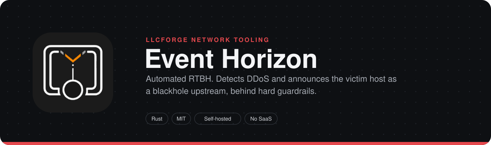
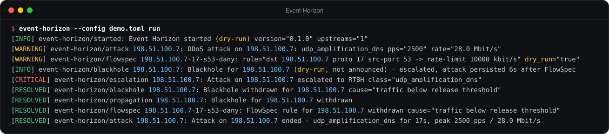
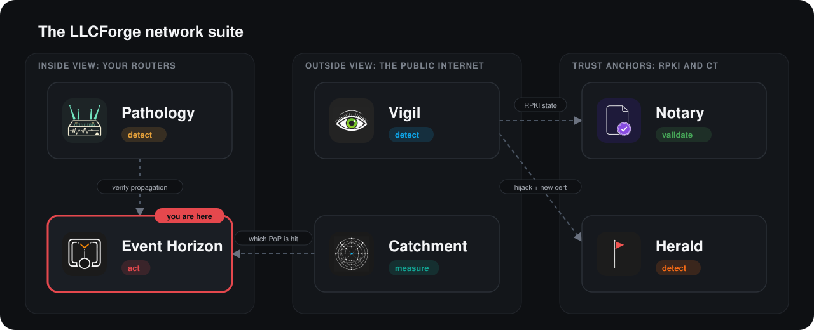

> **LLCForge network tooling** — self-hosted, Rust, no SaaS.
> [Pathology](https://github.com/LLCForge/Pathology) · **Event Horizon** · [Catchment](https://github.com/LLCForge/Catchment) · [Notary](https://github.com/LLCForge/Notary) · [Herald](https://github.com/LLCForge/Herald) · [Vigil](https://github.com/LLCForge/Vigil)

<!-- readme-visuals -->
<p align="center">
  
</p>

<p align="center">Automated RTBH in Rust. On DDoS detection it announces the victim prefix as a blackhole and sends the BGP community upstream.</p>

<p align="center">
  <strong>English</strong> · <a href="README.tr.md">Türkçe</a>
</p>

<p align="center">
  <a href="LICENSE"></a>
  
  
</p>

---

## Why

When a volumetric attack saturates your transit links, nothing you do inside your network helps. Remotely Triggered Black Hole routing pushes the drop to your upstream, sacrificing one target address to save everything else. Doing that by hand at 3 a.m. is slow and error-prone; Event Horizon does it in seconds, with hard guardrails so it can never blackhole something it should not. Where your upstream supports BGP FlowSpec it first rate-limits only the attack traffic and keeps the victim reachable, and escalates to a blackhole only when that is not enough.

## Demo

<p align="center">
  
</p>

<sub>Real output of `event-horizon --config demo.toml run` in dry-run mode while a local sender replays a DNS amplification pattern as sFlow, on sample data that uses documentation address ranges and private ASNs: detection, FlowSpec rate-limit, escalation to RTBH, release and the attack report (long lines shortened).</sub>

## Features

**Detection**

- **sFlow v5** collector: flow samples with raw packet headers (Ethernet with up to two VLAN tags, IPv4, IPv6) plus the extended gateway record for the source AS, scaled by sampling rate.
- **NetFlow v9 and IPFIX** collector on one UDP socket: templates cached per exporter, observation domain / source id and version (bounded cache, IPFIX template withdrawal, variable-length and enterprise fields), sampling rate from the record or from config.
- Per-destination pps / Mbps over a sliding window with hysteresis (`threshold`, `release`, `trigger_after`, `release_after`), optionally with **dynamic EWMA baselines** that lower the threshold for quiet hosts (never raise it). Only destinations inside `protected` are tracked; datagrams only from listed exporters.
- **Attack classification** by packet majority: UDP amplification by source port (DNS 53, NTP 123, memcached 11211, SSDP 1900, CLDAP 389, chargen 19), SYN flood (SYN without ACK), ICMP / ICMPv6 flood, generic UDP flood.
- **Per-victim attack report** at the end of every attack, as JSON and Markdown: duration, peak pps / bps, estimated volume, top source ASNs, source and destination ports, protocols and the mitigation timeline. Also at `GET /v1/reports`.

**Mitigation**

- **Policy engine** as the single deny-by-default choke point for everything that changes routing: protected-prefix allowlist, never list, special-address block (loopback, multicast, link-local, IPv4-mapped, ...), `max_active`, TTL min / default / max, dry-run. FlowSpec rules, escalations, regional scopes, restored state and approved requests all pass through it again at the moment they would be announced.
- **Announce-only eBGP speaker** (RFC 4271, 4-octet ASN per RFC 6793, IPv6 via RFC 4760): /32 and /128 host routes with ORIGIN IGP, AS_PATH `[local_asn]`, a discard next hop, BLACKHOLE (65535:666, RFC 7999), NO_EXPORT and per-upstream communities. Received routes are parsed safely and discarded.
- **BGP FlowSpec** (RFC 8955, IPv6 per RFC 8956) on its own SAFI 133: destination host prefix + protocol + source / destination port, action traffic-rate (rate-limit) or discard. Only sent to upstreams with `flowspec = true` that negotiated the AFI/SAFI.
- **Automatic escalation**: classified attacks get a FlowSpec rule first; if the attack is still running `escalate_after` later (or FlowSpec is denied or unavailable) the host route is blackholed.
- **Regional / selective blackholing**: per-upstream community maps (`regions = { eu = ["64496:6661"] }`) and an upstream subset per request; regional announcements carry NO_EXPORT and the provider's communities instead of the global BLACKHOLE community.
- **Graceful Restart** (RFC 4724) capability with End-of-RIB markers; on a planned restart upstreams keep the routes for `restart_time`.
- **Multihop eBGP** (`ebgp_multihop` TTL) and **local source address** selection.
- **TCP-MD5** (RFC 2385) session authentication on Linux. macOS and Windows do not expose `TCP_MD5SIG` to applications; a live session that requires it is refused at startup with a clear error.
- **Manual approval mode** (`off`, `detector`, `all`): requests wait for an operator, via the API or **Telegram inline buttons** (long polling, no inbound webhook). Only the configured chat and user ids count; no answer within `timeout` means deny.
- **Propagation verification**: periodically checks that each live blackhole is visible outside through the RIPEstat looking-glass and, optionally, Pathology's `/v1/prefixes/<p>/paths`; `GET /v1/blackholes` shows `propagation` per entry and a warning alert fires when it is not seen.
- **Automatic withdrawal** on TTL expiry or when the detector sees traffic below the release level (detector-created entries only). Active set persisted atomically and re-validated on restart.

**Operations**

- **Trigger API**: blackholes, FlowSpec rules, approvals and reports. Bearer token from the environment (constant-time compare), strict JSON schemas, body limit, global rate limit, `127.0.0.1` by default, **built-in TLS (rustls) with optional mutual TLS**.
- **Alerts** through the shared [llcforge-beacon](crates/llcforge-beacon) kit: Telegram, webhook with HMAC signature, Slack, Discord, Teams, e-mail, PagerDuty, Opsgenie, syslog and stdout, with a crash-safe queue, dedup, silences (`event-horizon silence add|list|remove`, `/v1/silences`) and per-resource routing. Events: attack, FlowSpec, blackhole, escalation, approval needed, policy denial of a detector request, BGP session down, propagation not seen.
- **Audit log** of every decision and UPDATE as JSON lines; **Prometheus** `/metrics`, `/healthz`, `/readyz`; JSON or text logs; configuration reload (SIGHUP, file change, `POST /v1/reload`); `event-horizon service install|uninstall|run`.
- **`simulate`** prints the policy decision and the exact UPDATE bytes for a blackhole (optionally with a regional scope) or a FlowSpec rule, without network access.

## Where it fits in the suite

Event Horizon is the only tool in the suite that **changes routing**. It pairs naturally with [Pathology](https://github.com/LLCForge/Pathology) (confirm your blackhole route actually propagated: Event Horizon can ask Pathology directly), [Vigil](https://github.com/LLCForge/Vigil) (polls `GET /v1/blackholes` and checks visibility from public collectors) and [Catchment](https://github.com/LLCForge/Catchment) (see which anycast PoP is absorbing the attack before deciding to blackhole).

<p align="center">
  
</p>

## Installation

Release archives for Linux (musl, x86_64 / aarch64), macOS (Intel / Apple Silicon) and Windows (x86_64 / arm64) are signed (cosign) with a `SHA256SUMS` file. Every package installs the example configuration in dry-run mode.

**Linux (Debian / Ubuntu, RHEL / Fedora, systemd)**

```bash
sudo apt install ./event-horizon_<version>_amd64.deb        # or: sudo dnf install ./event-horizon-<version>.x86_64.rpm
sudoedit /etc/event-horizon/event-horizon.toml
echo 'EVENT_HORIZON_API_TOKEN=<32+ random characters>' | sudo tee /etc/event-horizon/event-horizon.env
sudo chmod 600 /etc/event-horizon/event-horizon.env
sudo systemctl enable --now event-horizon
sudo systemctl reload event-horizon                         # SIGHUP: reload configuration
```

The unit runs with a dynamic user, no capabilities and `StateDirectory=/var/lib/event-horizon`. Event Horizon only connects out to BGP peers; collectors default to unprivileged ports (6343, 2055).

**macOS (Homebrew, launchd)**

```bash
brew install llcforge/tap/event-horizon
sudo cp packaging/launchd/net.llcforge.event-horizon.plist /Library/LaunchDaemons/   # steps are in the plist header
sudo launchctl bootstrap system /Library/LaunchDaemons/net.llcforge.event-horizon.plist
```

**Windows (Scoop, winget, Windows service)**

```powershell
scoop install .\event-horizon.json        # manifest from the release package-manifests archive
# or: winget install LLCForge.Event-Horizon
.\install-service.ps1 -Config .\event-horizon.example.toml -EnvFile .\event-horizon.env   # elevated, from the release zip
```

See [packaging/windows/README.md](packaging/windows/README.md). The service runs as `NT AUTHORITY\LocalService`; data lives in `C:\ProgramData\LLCForge\event-horizon`.

**Docker / Compose**

```bash
docker run -d --name event-horizon -v $PWD/event-horizon.toml:/etc/event-horizon/event-horizon.toml:ro \
  -v eh-data:/data --env-file event-horizon.env -p 127.0.0.1:9180:9180 ghcr.io/llcforge/event-horizon:latest
```

[`docker-compose.yml`](docker-compose.yml) does the same with a read-only root filesystem. Bind `metrics.listen` to `0.0.0.0:9180` inside the container so the health probes work.

**Kubernetes (Helm)**

```bash
helm install event-horizon deploy/helm/event-horizon -f my-values.yaml
```

The chart ships a ConfigMap from `values.config`, a PVC for `/data`, probes on `/healthz` and `/readyz`, and an optional ServiceMonitor. Grafana dashboard and Prometheus rules: [`deploy/grafana`](deploy/grafana), [`deploy/prometheus`](deploy/prometheus).

**From source**

Requirements: a stable Rust toolchain 1.88+ ([rustup.rs](https://rustup.rs)). No system libraries are needed; it builds on Linux, macOS and Windows.

## Quick start

> **Status:** pre-release. Configuration keys and CLI flags may change before 1.0.

```bash
git clone https://github.com/LLCForge/Event-Horizon.git
cd Event-Horizon
cargo build --release
cp event-horizon.example.toml event-horizon.toml     # then edit addresses, ASNs and prefixes
./target/release/event-horizon --config event-horizon.toml check-config
./target/release/event-horizon --config event-horizon.toml simulate --dst 198.51.100.7
export EVENT_HORIZON_API_TOKEN="$(openssl rand -hex 32)"
./target/release/event-horizon --config event-horizon.toml run
```

Minimal `event-horizon.toml` (addresses use documentation ranges, replace with your own; [`event-horizon.example.toml`](event-horizon.example.toml) shows every key, including FlowSpec, approval, NetFlow, propagation, TLS and alert sinks):

```toml
dry_run = true                      # start here, flip to false after testing

[bgp]
local_asn = 64500
router_id = "192.0.2.10"
next_hop_v4 = "192.0.2.1"           # discard next hop, null-routed on your edge
next_hop_v6 = "100::1"              # RFC 6666 discard prefix

[[bgp.upstream]]
name = "transit-a"
neighbor = "203.0.113.1"
remote_asn = 64496
communities = ["64496:666"]         # 65535:666 and NO_EXPORT are always added
flowspec = true                     # also send FlowSpec rules to this upstream

[guardrails]
protected = ["198.51.100.0/24", "2001:db8:100::/48"]   # only these may be blackholed
never = ["198.51.100.1/32"]                             # e.g. your DNS resolver
max_active = 16
ttl = { min = "5m", default = "30m", max = "6h" }

[flowspec]
action = "rate-limit"               # FlowSpec first ...
rate_limit_kbps = 10000
escalate_after = "2m"               # ... RTBH if the attack is still running

[api]
listen = "127.0.0.1:9179"
token_env = "EVENT_HORIZON_API_TOKEN"

[metrics]
listen = "127.0.0.1:9180"

[detect]
threshold = { pps = 500000, mbps = 2000 }
release = { pps = 100000, mbps = 400 }
trigger_after = "30s"
release_after = "2m"

[detect.sflow]
listen = "0.0.0.0:6343"
exporters = ["192.0.2.21"]
```

Other keys and their defaults: `data_dir` (default `$STATE_DIRECTORY` or the platform data directory), `state_file` and `audit_log` (inside `data_dir` unless set), `[log] format = "text" | "json"`, `level = "info"`, `bgp.hold_time = 90`, `bgp.upstream.port = 179`, `api.max_body_bytes = 4096`, `api.rate_limit_per_minute = 60`, `detect.window = "10s"`. A missing `release` value defaults to half of the matching `threshold`. Thresholds written under `[detect.sflow]` (older configs) still work. Unknown keys are rejected.

Secrets are always read from environment variables (`*_env` keys name the variable), never from the config file. The API token must be at least 32 characters.

## Usage

```bash
event-horizon --config event-horizon.toml check-config   # validate and print a summary
event-horizon --config event-horizon.toml simulate --dst 198.51.100.7 [--ttl 1h] [--active 3] [--scope eu]
event-horizon --config event-horizon.toml simulate --dst 198.51.100.7 --protocol udp --src-port 53 [--discard]
event-horizon --config event-horizon.toml run            # speaker + detectors + API + metrics
event-horizon --config event-horizon.toml silence add --resource '198.51.100.*' --duration 2h -m "maintenance"
event-horizon --config event-horizon.toml service install|uninstall|run
```

`simulate` exits with `0` when the policy allows the request and `2` when it denies it, so it can be used in scripts. FlowSpec example:

```text
decision  ALLOW flowspec dst 198.51.100.7 proto 17 src-port 53 -> rate-limit 10000 kbit/s ttl=30m dry_run=true
upstream  transit-a AS64496 203.0.113.1:179
  flowspec UPDATE (SAFI 133), 69 bytes
    ffff ffff ffff ffff ffff ffff ffff ffff
    0045 0200 0000 2e40 0101 0040 0206 0201
    0000 fbf4 800e 1300 0185 0000 0d01 20c6
    3364 0703 8111 0691 0035 c010 0880 06fb
    f449 9896 80
    MATCH dst 198.51.100.7/32 proto 17 src-port 53
    ACTION traffic-rate 1250000 bytes/s
upstream  transit-b AS64497: flowspec not enabled, skipped
```

Trigger API (from the host itself, or with `[api.tls]`):

```bash
H="Authorization: Bearer $EVENT_HORIZON_API_TOKEN"
curl -s -H "$H" -H 'Content-Type: application/json' \
     -d '{"ip":"198.51.100.7","ttl":"30m","reason":"udp flood"}' http://127.0.0.1:9179/v1/blackholes
curl -s -H "$H" -H 'Content-Type: application/json' \
     -d '{"ip":"198.51.100.8","reason":"regional","scope":"eu","upstreams":["transit-a"]}' http://127.0.0.1:9179/v1/blackholes
curl -s -H "$H" -H 'Content-Type: application/json' \
     -d '{"dst":"198.51.100.7","protocol":"udp","src_port":123,"action":"rate-limit","rate_kbps":5000,"reason":"ntp amp"}' \
     http://127.0.0.1:9179/v1/flowspec
curl -s -H "$H" http://127.0.0.1:9179/v1/blackholes          # each entry has "propagation"
curl -s -H "$H" -X DELETE http://127.0.0.1:9179/v1/blackholes/198.51.100.7
curl -s -H "$H" http://127.0.0.1:9179/v1/approvals
curl -s -H "$H" -X POST http://127.0.0.1:9179/v1/approvals/<id>/approve    # or /deny
curl -s -H "$H" http://127.0.0.1:9179/v1/reports
```

Responses: `201` created, `202` waiting for approval, `403` denied by policy (`code` says why, e.g. `not_protected`, `never_list`, `max_active`, `flowspec_action`), `409` already active, `422` invalid TTL, reason, scope, port or protocol, `401` bad token, `429` rate limited or too many pending approvals, `404` nothing to delete. `ttl` uses the config format (`90s`, `5m`, `6h`, `1d`).

`GET /v1/blackholes` returns `{"blackholes":[{ip, reason, source, created_at, expires_at, dry_run, propagation: {checked_at, visible_peers, status}}]}` with `status` one of `unknown`, `propagated`, `not_seen` (`checked_at` is Unix seconds, `0` = not checked yet). This is the contract other LLCForge tools read.

**Platform notes.**

- TCP-MD5 is Linux only (`setsockopt(TCP_MD5SIG)`, no extra privileges). On macOS and Windows a live run with `md5_password_env` fails at startup with an explanation; `check-config` flags it. Use a direct link or a protected path there.
- No raw sockets are used; everything runs as an unprivileged user on every OS. Binding the collectors to ports below 1024 needs `CAP_NET_BIND_SERVICE` (Linux), root (macOS) or an administrator firewall rule (Windows).

**Safety notes.**

- Keep `dry_run = true` until `simulate` and the audit log show exactly what you expect. In dry-run no BGP session is opened; the UPDATEs that would be sent are logged and audited.
- Entries created in dry-run are discarded when you restart in live mode, so testing never turns into real blackholes. `dry_run` cannot change on a configuration reload.
- The API binds to `127.0.0.1` by default. If it must be reachable from elsewhere, enable `[api.tls]` (optionally with `client_ca_file` for mutual TLS); the bearer token is still required.
- On shutdown without Graceful Restart the speaker sends a Cease NOTIFICATION and upstreams drop the routes with the session. With `graceful_restart` it closes without a NOTIFICATION and upstreams keep the routes for `restart_time`; after a restart the active set is re-announced and End-of-RIB flushes anything that is gone.
- Many upstreams validate FlowSpec rules against the best unicast route (RFC 8955 section 6) or only accept them on dedicated sessions; agree on this with your provider before enabling `flowspec`.
- Use a dedicated Telegram bot for approvals: `getUpdates` cannot be shared with another consumer of the same bot.

## How it works

See [ARCHITECTURE.md](ARCHITECTURE.md) for components, data flow, trust boundaries and failure modes.

## Roadmap

- TCP-AO (RFC 5925) session authentication: not exposed portably by any of the three operating systems yet.
- TCP-MD5 on macOS and Windows: the operating systems do not offer it to applications.
- NetFlow v9 / IPFIX option templates (exporter-announced sampling rates) are ignored; set `sampling_rate` or export the sampling interval per record.
- FlowSpec components beyond destination prefix, protocol and ports (TCP flags, packet length, fragments, ICMP type) and the redirect / traffic-marking actions.
- IPv6 extension headers are not walked when reading ports from sFlow raw headers.
- Pending approvals are kept in memory only; a restart drops them (which equals deny).

## Related tools

- [Pathology](https://github.com/LLCForge/Pathology): BGP route monitor for your own routers and BMP feeds. Learns the AS paths and origins your prefixes normally use, then alerts on any deviation.
- [Catchment](https://github.com/LLCForge/Catchment): Anycast prober. Runs traceroutes from vantage points worldwide and maps which PoP the traffic actually lands in.
- [Vigil](https://github.com/LLCForge/Vigil): Real-time origin hijack detection over public RIPE RIS and RouteViews feeds. Flags the moment someone else announces your prefix.

## Contributing

Issues and pull requests are welcome. Read [CONTRIBUTING.md](CONTRIBUTING.md) and the [Code of Conduct](CODE_OF_CONDUCT.md) first. Found a vulnerability? Do **not** open a public issue; follow [SECURITY.md](SECURITY.md).

## License

Event Horizon is free and open-source software released under the [MIT License](LICENSE). See [NOTICE](NOTICE) for attributions.
