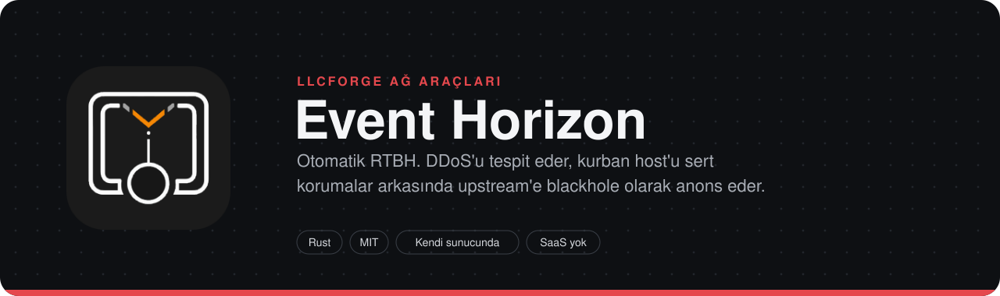
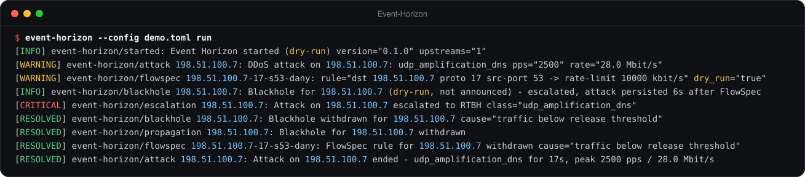
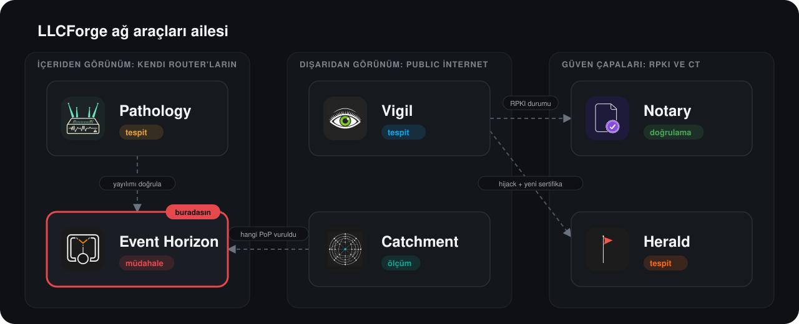

> **LLCForge ağ araçları** — kendi sunucunda, Rust, SaaS yok.
> [Pathology](https://github.com/LLCForge/Pathology) · **Event Horizon** · [Catchment](https://github.com/LLCForge/Catchment) · [Notary](https://github.com/LLCForge/Notary) · [Herald](https://github.com/LLCForge/Herald) · [Vigil](https://github.com/LLCForge/Vigil)

<!-- readme-visuals -->
<p align="center">
  
</p>

<p align="center">Rust ile otomatik RTBH. DDoS tespit ettiğinde kurban prefix'i blackhole olarak anons eder ve BGP community'sini upstream'e gönderir.</p>

<p align="center">
  <a href="README.md">English</a> · <strong>Türkçe</strong>
</p>

<p align="center">
  <a href="LICENSE"></a>
  
  
</p>

---

## Neden

Hacimsel bir saldırı transit bağlantılarını doldurduğunda ağının içinde yapacağın hiçbir şey işe yaramaz. Remotely Triggered Black Hole yönlendirmesi, trafiği düşürme işini upstream'e taşır; tek bir hedef adresi feda ederek geri kalan her şeyi kurtarır. Bunu gece 3'te elle yapmak yavaş ve hataya açıktır; Event Horizon bunu saniyeler içinde, yanlış bir şeyi asla blackhole'a atamayacak sert korumalarla yapar. Upstream'in BGP FlowSpec destekliyorsa önce yalnızca saldırı trafiğini sınırlar ve kurbanı erişilebilir tutar; bu yetmezse blackhole'a geçer.

## Örnek çıktı

<p align="center">
  
</p>

<sub>Yerel bir gönderici DNS amplification örüntüsünü sFlow olarak tekrar oynatırken, dry-run modunda `event-horizon --config demo.toml run` komutunun dokümantasyon adres aralıkları ve özel ASN'ler kullanan örnek veri üzerindeki gerçek çıktısı: tespit, FlowSpec hız sınırı, RTBH'ye yükseltme, serbest bırakma ve saldırı raporu (uzun satırlar kısaltıldı).</sub>

## Özellikler

**Tespit**

- **sFlow v5** toplayıcı: ham paket başlığı taşıyan flow örnekleri (en fazla iki VLAN etiketli Ethernet, IPv4, IPv6) ve kaynak AS için extended gateway kaydı; değerler örnekleme oranıyla ölçeklenir.
- Tek UDP soketinde **NetFlow v9 ve IPFIX** toplayıcı: şablonlar exporter, observation domain / source id ve sürüm başına önbelleğe alınır (sınırlı önbellek, IPFIX şablon geri çekme, değişken uzunluklu ve enterprise alanlar); örnekleme oranı kayıttan ya da yapılandırmadan gelir.
- Kayan pencere üzerinde hedef başına pps / Mbps ve histerezis (`threshold`, `release`, `trigger_after`, `release_after`); isteğe bağlı **dinamik EWMA taban çizgileri** sessiz host'lar için eşiği düşürür (asla yükseltmez). Yalnızca `protected` içindeki hedefler izlenir; datagram'lar yalnızca listelenen exporter'lardan kabul edilir.
- Paket çoğunluğuna göre **saldırı sınıflandırma**: kaynak porta göre UDP amplification (DNS 53, NTP 123, memcached 11211, SSDP 1900, CLDAP 389, chargen 19), SYN flood (ACK'sız SYN), ICMP / ICMPv6 flood, genel UDP flood.
- Her saldırının sonunda JSON ve Markdown olarak **kurban başına saldırı raporu**: süre, tepe pps / bps, tahmini hacim, en çok trafik gönderen kaynak ASN'ler, kaynak ve hedef portlar, protokoller ve azaltma zaman çizelgesi. `GET /v1/reports` ile de alınır.

**Azaltma**

- Yönlendirmeyi değiştiren her şey için tek geçiş noktası olan, varsayılanı reddetmek olan **politika motoru**: korunan prefix allowlist'i, never listesi, özel adres engeli (loopback, multicast, link-local, IPv4-mapped, ...), `max_active`, minimum / varsayılan / maksimum TTL, dry-run. FlowSpec kuralları, yükseltmeler, bölgesel kapsamlar, diskten geri yüklenen durum ve onaylanan istekler anons edilecekleri anda politikadan yeniden geçer.
- **Yalnızca anons eden eBGP speaker** (RFC 4271, RFC 6793 ile 4 baytlık ASN, RFC 4760 ile IPv6): ORIGIN IGP, AS_PATH `[local_asn]`, discard next hop, BLACKHOLE (65535:666, RFC 7999), NO_EXPORT ve upstream'e özel community'lerle /32 ve /128 host rotaları. Alınan rotalar güvenli biçimde ayrıştırılıp atılır.
- Kendi SAFI 133'ü üzerinde **BGP FlowSpec** (RFC 8955, IPv6 için RFC 8956): hedef host prefix'i + protokol + kaynak / hedef port, eylem traffic-rate (hız sınırı) veya discard. Yalnızca `flowspec = true` olan ve AFI/SAFI'yi anlaşan upstream'lere gönderilir.
- **Otomatik yükseltme**: sınıflandırılan saldırıya önce FlowSpec kuralı uygulanır; saldırı `escalate_after` sonra hâlâ sürüyorsa (ya da FlowSpec reddedildiyse veya yoksa) host rotası blackhole'a atılır.
- **Bölgesel / seçici blackhole**: upstream başına community haritaları (`regions = { eu = ["64496:6661"] }`) ve istek başına upstream alt kümesi; bölgesel anonslar global BLACKHOLE community'si yerine NO_EXPORT ve sağlayıcının community'lerini taşır.
- End-of-RIB işaretleriyle **Graceful Restart** (RFC 4724) yeteneği; planlı yeniden başlatmada upstream'ler rotaları `restart_time` boyunca tutar.
- **Multihop eBGP** (`ebgp_multihop` TTL) ve **yerel kaynak adres** seçimi.
- Linux'ta **TCP-MD5** (RFC 2385) oturum kimlik doğrulaması. macOS ve Windows `TCP_MD5SIG`'i uygulamalara açmaz; bunu gerektiren canlı bir oturum başlangıçta açık bir hatayla reddedilir.
- **Manuel onay modu** (`off`, `detector`, `all`): istekler bir operatörü bekler; API ya da **Telegram satır içi butonları** ile (long polling, dışarıdan gelen webhook yok). Yalnızca yapılandırılan sohbet ve kullanıcı kimlikleri geçerlidir; `timeout` içinde yanıt yoksa ret sayılır.
- **Yayılım doğrulama**: her canlı blackhole'un dışarıdan görünüp görünmediğini RIPEstat looking-glass ve isteğe bağlı olarak Pathology'nin `/v1/prefixes/<p>/paths` uç noktasıyla düzenli kontrol eder; `GET /v1/blackholes` her kayıtta `propagation` gösterir, görünmezse uyarı alarmı üretilir.
- TTL dolduğunda veya tespit trafiğin serbest bırakma seviyesinin altına düştüğünü gördüğünde **otomatik geri çekme** (yalnızca tespitin oluşturduğu kayıtlar). Aktif küme atomik olarak kaydedilir ve yeniden başlatmada yeniden doğrulanır.

**İşletim**

- **Tetikleme API'si**: blackhole'lar, FlowSpec kuralları, onaylar ve raporlar. Ortam değişkeninden bearer token (sabit zamanlı karşılaştırma), katı JSON şemaları, gövde sınırı, genel hız sınırı, varsayılan `127.0.0.1`, **yerleşik TLS (rustls) ve isteğe bağlı karşılıklı TLS**.
- Ortak [llcforge-beacon](crates/llcforge-beacon) kiti ile **alarmlar**: Telegram, HMAC imzalı webhook, Slack, Discord, Teams, e-posta, PagerDuty, Opsgenie, syslog ve stdout; çökmeye dayanıklı kuyruk, tekrar bastırma, susturmalar (`event-horizon silence add|list|remove`, `/v1/silences`) ve kaynak bazlı yönlendirme. Olaylar: saldırı, FlowSpec, blackhole, yükseltme, onay gerekli, tespit isteğinin politika reddi, BGP oturumu düştü, yayılım görülmedi.
- Her karar ve UPDATE için JSON satırları olarak **audit log**; **Prometheus** `/metrics`, `/healthz`, `/readyz`; JSON veya metin loglar; yapılandırmayı yeniden yükleme (SIGHUP, dosya değişikliği, `POST /v1/reload`); `event-horizon service install|uninstall|run`.
- **`simulate`**, bir blackhole (isteğe bağlı bölgesel kapsamla) veya FlowSpec kuralı için politika kararını ve tam UPDATE baytlarını ağa çıkmadan yazdırır.

## Ailedeki yeri

Event Horizon, ailede **yönlendirmeyi değiştiren** tek araçtır. [Pathology](https://github.com/LLCForge/Pathology) (blackhole rotanın gerçekten yayıldığını doğrula: Event Horizon doğrudan Pathology'ye sorabilir), [Vigil](https://github.com/LLCForge/Vigil) (`GET /v1/blackholes` uç noktasını yoklar ve görünürlüğü public collector'lardan kontrol eder) ve [Catchment](https://github.com/LLCForge/Catchment) (blackhole'a karar vermeden önce saldırıyı hangi anycast PoP'unun karşıladığını gör) ile doğal olarak birlikte çalışır.

<p align="center">
  
</p>

## Kurulum

Linux (musl, x86_64 / aarch64), macOS (Intel / Apple Silicon) ve Windows (x86_64 / arm64) sürüm arşivleri cosign ile imzalıdır ve bir `SHA256SUMS` dosyasıyla gelir. Her paket örnek yapılandırmayı dry-run modunda kurar.

**Linux (Debian / Ubuntu, RHEL / Fedora, systemd)**

```bash
sudo apt install ./event-horizon_<sürüm>_amd64.deb          # ya da: sudo dnf install ./event-horizon-<sürüm>.x86_64.rpm
sudoedit /etc/event-horizon/event-horizon.toml
echo 'EVENT_HORIZON_API_TOKEN=<32+ rastgele karakter>' | sudo tee /etc/event-horizon/event-horizon.env
sudo chmod 600 /etc/event-horizon/event-horizon.env
sudo systemctl enable --now event-horizon
sudo systemctl reload event-horizon                         # SIGHUP: yapılandırmayı yeniden yükle
```

Unit dinamik bir kullanıcıyla, hiçbir yetki (capability) olmadan ve `StateDirectory=/var/lib/event-horizon` ile çalışır. Event Horizon BGP komşularına yalnızca dışarı bağlanır; toplayıcılar varsayılan olarak ayrıcalık gerektirmeyen portları (6343, 2055) kullanır.

**macOS (Homebrew, launchd)**

```bash
brew install llcforge/tap/event-horizon
sudo cp packaging/launchd/net.llcforge.event-horizon.plist /Library/LaunchDaemons/   # adımlar plist başlığında
sudo launchctl bootstrap system /Library/LaunchDaemons/net.llcforge.event-horizon.plist
```

**Windows (Scoop, winget, Windows servisi)**

```powershell
scoop install .\event-horizon.json        # sürümün package-manifests arşivindeki manifest
# ya da: winget install LLCForge.Event-Horizon
.\install-service.ps1 -Config .\event-horizon.example.toml -EnvFile .\event-horizon.env   # yönetici olarak, sürüm zip'inden
```

Ayrıntılar [packaging/windows/README.md](packaging/windows/README.md) dosyasında. Servis `NT AUTHORITY\LocalService` olarak çalışır; veriler `C:\ProgramData\LLCForge\event-horizon` altındadır.

**Docker / Compose**

```bash
docker run -d --name event-horizon -v $PWD/event-horizon.toml:/etc/event-horizon/event-horizon.toml:ro \
  -v eh-data:/data --env-file event-horizon.env -p 127.0.0.1:9180:9180 ghcr.io/llcforge/event-horizon:latest
```

[`docker-compose.yml`](docker-compose.yml) aynısını salt okunur kök dosya sistemiyle yapar. Sağlık yoklamalarının çalışması için konteyner içinde `metrics.listen` değerini `0.0.0.0:9180` yap.

**Kubernetes (Helm)**

```bash
helm install event-horizon deploy/helm/event-horizon -f my-values.yaml
```

Chart, `values.config` içeriğinden bir ConfigMap, `/data` için PVC, `/healthz` ve `/readyz` yoklamaları ve isteğe bağlı bir ServiceMonitor içerir. Grafana panosu ve Prometheus kuralları: [`deploy/grafana`](deploy/grafana), [`deploy/prometheus`](deploy/prometheus).

**Kaynaktan**

Gereksinim: kararlı Rust araç zinciri 1.88+ ([rustup.rs](https://rustup.rs)). Sistem kütüphanesi gerekmez; Linux, macOS ve Windows'ta derlenir.

## Hızlı başlangıç

> **Durum:** yayın öncesi. Yapılandırma anahtarları ve CLI parametreleri 1.0'dan önce değişebilir.

```bash
git clone https://github.com/LLCForge/Event-Horizon.git
cd Event-Horizon
cargo build --release
cp event-horizon.example.toml event-horizon.toml     # ardından adresleri, ASN'leri ve prefix'leri düzenle
./target/release/event-horizon --config event-horizon.toml check-config
./target/release/event-horizon --config event-horizon.toml simulate --dst 198.51.100.7
export EVENT_HORIZON_API_TOKEN="$(openssl rand -hex 32)"
./target/release/event-horizon --config event-horizon.toml run
```

Minimal `event-horizon.toml` (adresler dokümantasyon aralıklarıdır, kendi değerlerinle değiştir; FlowSpec, onay, NetFlow, yayılım, TLS ve alarm hedefleri dahil tüm anahtarlar [`event-horizon.example.toml`](event-horizon.example.toml) dosyasında):

```toml
dry_run = true                      # buradan başla, test ettikten sonra false yap

[bgp]
local_asn = 64500
router_id = "192.0.2.10"
next_hop_v4 = "192.0.2.1"           # discard next hop, kenar router'ında null'a yönlendirilir
next_hop_v6 = "100::1"              # RFC 6666 discard prefix'i

[[bgp.upstream]]
name = "transit-a"
neighbor = "203.0.113.1"
remote_asn = 64496
communities = ["64496:666"]         # 65535:666 ve NO_EXPORT her zaman eklenir
flowspec = true                     # bu upstream'e FlowSpec kuralları da gönder

[guardrails]
protected = ["198.51.100.0/24", "2001:db8:100::/48"]   # yalnızca bunlar blackhole'a atılabilir
never = ["198.51.100.1/32"]                             # ör. DNS çözümleyicin
max_active = 16
ttl = { min = "5m", default = "30m", max = "6h" }

[flowspec]
action = "rate-limit"               # önce FlowSpec ...
rate_limit_kbps = 10000
escalate_after = "2m"               # ... saldırı sürerse RTBH

[api]
listen = "127.0.0.1:9179"
token_env = "EVENT_HORIZON_API_TOKEN"

[metrics]
listen = "127.0.0.1:9180"

[detect]
threshold = { pps = 500000, mbps = 2000 }
release = { pps = 100000, mbps = 400 }
trigger_after = "30s"
release_after = "2m"

[detect.sflow]
listen = "0.0.0.0:6343"
exporters = ["192.0.2.21"]
```

Diğer anahtarlar ve varsayılanları: `data_dir` (varsayılan `$STATE_DIRECTORY` ya da platformun veri dizini), `state_file` ve `audit_log` (ayarlanmazsa `data_dir` içinde), `[log] format = "text" | "json"`, `level = "info"`, `bgp.hold_time = 90`, `bgp.upstream.port = 179`, `api.max_body_bytes = 4096`, `api.rate_limit_per_minute = 60`, `detect.window = "10s"`. Eksik bir `release` değeri, karşılık gelen `threshold` değerinin yarısı kabul edilir. `[detect.sflow]` altına yazılmış eşikler (eski yapılandırmalar) çalışmaya devam eder. Bilinmeyen anahtarlar reddedilir.

Gizli bilgiler her zaman ortam değişkenlerinden okunur (`*_env` anahtarları değişkenin adını verir), asla yapılandırma dosyasından okunmaz. API token'ı en az 32 karakter olmalıdır.

## Kullanım

```bash
event-horizon --config event-horizon.toml check-config   # doğrula ve özet yazdır
event-horizon --config event-horizon.toml simulate --dst 198.51.100.7 [--ttl 1h] [--active 3] [--scope eu]
event-horizon --config event-horizon.toml simulate --dst 198.51.100.7 --protocol udp --src-port 53 [--discard]
event-horizon --config event-horizon.toml run            # speaker + tespit + API + metrikler
event-horizon --config event-horizon.toml silence add --resource '198.51.100.*' --duration 2h -m "bakım"
event-horizon --config event-horizon.toml service install|uninstall|run
```

`simulate`, politika isteğe izin verirse `0`, reddederse `2` çıkış koduyla döner; script'lerde kullanılabilir. FlowSpec örneği:

```text
decision  ALLOW flowspec dst 198.51.100.7 proto 17 src-port 53 -> rate-limit 10000 kbit/s ttl=30m dry_run=true
upstream  transit-a AS64496 203.0.113.1:179
  flowspec UPDATE (SAFI 133), 69 bytes
    ffff ffff ffff ffff ffff ffff ffff ffff
    0045 0200 0000 2e40 0101 0040 0206 0201
    0000 fbf4 800e 1300 0185 0000 0d01 20c6
    3364 0703 8111 0691 0035 c010 0880 06fb
    f449 9896 80
    MATCH dst 198.51.100.7/32 proto 17 src-port 53
    ACTION traffic-rate 1250000 bytes/s
upstream  transit-b AS64497: flowspec not enabled, skipped
```

Tetikleme API'si (makinenin kendisinden ya da `[api.tls]` ile):

```bash
H="Authorization: Bearer $EVENT_HORIZON_API_TOKEN"
curl -s -H "$H" -H 'Content-Type: application/json' \
     -d '{"ip":"198.51.100.7","ttl":"30m","reason":"udp flood"}' http://127.0.0.1:9179/v1/blackholes
curl -s -H "$H" -H 'Content-Type: application/json' \
     -d '{"ip":"198.51.100.8","reason":"bölgesel","scope":"eu","upstreams":["transit-a"]}' http://127.0.0.1:9179/v1/blackholes
curl -s -H "$H" -H 'Content-Type: application/json' \
     -d '{"dst":"198.51.100.7","protocol":"udp","src_port":123,"action":"rate-limit","rate_kbps":5000,"reason":"ntp amp"}' \
     http://127.0.0.1:9179/v1/flowspec
curl -s -H "$H" http://127.0.0.1:9179/v1/blackholes          # her kayıtta "propagation" var
curl -s -H "$H" -X DELETE http://127.0.0.1:9179/v1/blackholes/198.51.100.7
curl -s -H "$H" http://127.0.0.1:9179/v1/approvals
curl -s -H "$H" -X POST http://127.0.0.1:9179/v1/approvals/<id>/approve    # ya da /deny
curl -s -H "$H" http://127.0.0.1:9179/v1/reports
```

Yanıtlar: `201` oluşturuldu, `202` onay bekliyor, `403` politika reddetti (`code` nedenini söyler, ör. `not_protected`, `never_list`, `max_active`, `flowspec_action`), `409` zaten aktif, `422` geçersiz TTL, açıklama, kapsam, port veya protokol, `401` hatalı token, `429` hız sınırı ya da çok fazla bekleyen onay, `404` silinecek kayıt yok. `ttl` yapılandırmayla aynı biçimi kullanır (`90s`, `5m`, `6h`, `1d`).

`GET /v1/blackholes`, `{"blackholes":[{ip, reason, source, created_at, expires_at, dry_run, propagation: {checked_at, visible_peers, status}}]}` döndürür; `status` değeri `unknown`, `propagated` veya `not_seen` olur (`checked_at` Unix saniyesidir, `0` = henüz kontrol edilmedi). Diğer LLCForge araçlarının okuduğu sözleşme budur.

**Platform notları.**

- TCP-MD5 yalnızca Linux'ta vardır (`setsockopt(TCP_MD5SIG)`, ek yetki gerekmez). macOS ve Windows'ta `md5_password_env` içeren canlı bir çalıştırma açıklamalı bir hatayla başlangıçta durur; `check-config` bunu işaretler. Oralarda doğrudan bağlantı ya da korunan bir yol kullan.
- Ham soket kullanılmaz; her işletim sisteminde ayrıcalıksız kullanıcıyla çalışır. Toplayıcıları 1024'ün altındaki portlara bağlamak Linux'ta `CAP_NET_BIND_SERVICE`, macOS'ta root, Windows'ta yönetici güvenlik duvarı kuralı gerektirir.

**Güvenlik notları.**

- `simulate` ve audit log tam olarak beklediğini gösterene kadar `dry_run = true` bırak. Dry-run'da hiçbir BGP oturumu açılmaz; gönderilecek UPDATE'ler loglanır ve audit log'a yazılır.
- Dry-run'da oluşturulan kayıtlar canlı modda yeniden başlatınca atılır; test asla gerçek blackhole'a dönüşmez. `dry_run` yapılandırma yeniden yüklemesiyle değiştirilemez.
- API varsayılan olarak `127.0.0.1` adresine bağlanır. Başka yerden erişilmesi gerekiyorsa `[api.tls]` etkinleştir (karşılıklı TLS için isteğe bağlı `client_ca_file`); bearer token yine de gerekir.
- Graceful Restart yoksa kapatmada speaker Cease NOTIFICATION gönderir ve upstream'ler rotaları oturumla birlikte düşürür. `graceful_restart` ile NOTIFICATION göndermeden kapanır ve upstream'ler rotaları `restart_time` boyunca tutar; yeniden başlatmadan sonra aktif küme yeniden anons edilir ve End-of-RIB artık olmayanları temizler.
- Birçok upstream FlowSpec kurallarını en iyi unicast rotaya göre doğrular (RFC 8955 bölüm 6) ya da yalnızca ayrı oturumlarda kabul eder; `flowspec` açmadan önce bunu sağlayıcınla netleştir.
- Onaylar için ayrı bir Telegram botu kullan: `getUpdates` aynı botun başka bir tüketicisiyle paylaşılamaz.

## Nasıl çalışır

Bileşenler, veri akışı, güven sınırları ve hata senaryoları için [ARCHITECTURE.md](ARCHITECTURE.md) dosyasına bak.

## Yol haritası

- TCP-AO (RFC 5925) oturum kimlik doğrulaması: üç işletim sisteminin hiçbiri bunu henüz taşınabilir biçimde sunmuyor.
- macOS ve Windows'ta TCP-MD5: işletim sistemleri bunu uygulamalara sunmuyor.
- NetFlow v9 / IPFIX option şablonları (exporter'ın duyurduğu örnekleme oranları) yok sayılır; `sampling_rate` ayarla ya da örnekleme aralığını kayıt başına dışa aktar.
- Hedef prefix, protokol ve portlar dışındaki FlowSpec bileşenleri (TCP bayrakları, paket boyu, fragment, ICMP türü) ile redirect / traffic-marking eylemleri.
- sFlow ham başlıklarından port okunurken IPv6 uzantı başlıkları izlenmez.
- Bekleyen onaylar yalnızca bellekte tutulur; yeniden başlatma onları düşürür (bu, ret demektir).

## İlgili araçlar

- [Pathology](https://github.com/LLCForge/Pathology): Kendi router'ların ve BMP beslemelerin için BGP rota izleyici. Prefix'lerinin normalde kullandığı AS path'leri ve origin'leri öğrenir, en küçük sapmada alarm verir.
- [Catchment](https://github.com/LLCForge/Catchment): Anycast prober. Dünyanın dört bir yanındaki gözlem noktalarından traceroute çalıştırır ve trafiğin gerçekte hangi PoP'a düştüğünü haritalar.
- [Vigil](https://github.com/LLCForge/Vigil): Public RIPE RIS ve RouteViews feed'leri üzerinden gerçek zamanlı origin hijack tespiti. Başka biri prefix'ini anons ettiği an işaretler.

## Katkı

Issue ve pull request'ler memnuniyetle karşılanır. Önce [CONTRIBUTING.md](CONTRIBUTING.md) ve [Davranış Kuralları](CODE_OF_CONDUCT.md) dosyalarını oku. Bir güvenlik açığı mı buldun? Public issue **açma**; [SECURITY.md](SECURITY.md) adımlarını izle.

## Lisans

Event Horizon, [MIT Lisansı](LICENSE) ile yayınlanan özgür ve açık kaynak bir yazılımdır. Atıflar için [NOTICE](NOTICE) dosyasına bak.
